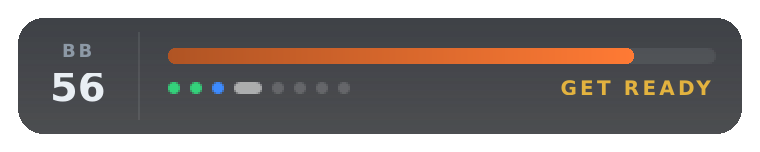

# Brake helper overlay (Pits n' Giggles)

A new HUD overlay for [Pits n' Giggles](https://github.com/ashwin-nat/pits-n-giggles) (MIT,
by Ashwin Natarajan) that shows when to brake for each corner, learned from your own best
braking, plus live brake bias tips. Kept as a patch so it can be re-applied when Pits n'
Giggles updates (and maybe offered upstream later).

## Run it on the racing PC

1. Download [Start-BrakeHelper.cmd](https://raw.githubusercontent.com/gremigaming/race-stats/main/brake-helper/Start-BrakeHelper.cmd)
   (right-click, Save link as) into the **same folder as your normal Pits n' Giggles exe**
   (the folder with `png_config.json`), so your settings (UDP forwarding to the telemetry
   recorder, car setups, overlay layout) carry over.
2. Close normal Pits n' Giggles, then double-click `Start-BrakeHelper.cmd`. The first time it
   downloads `PitsNGiggles-BrakeHelper.exe` (built by GitHub from this patch), later only when
   there is a newer build. Windows may say "Windows protected your PC" because the exe is not
   signed: click **More info**, then **Run anyway**.
3. In Pits n' Giggles go to **Settings > Overlays > Brake Helper**, tick **Enable brake helper
   overlay** and save (the app restarts the HUD). Move, lock, scale, opacity and show/hide work
   like the other overlays.
4. Drive. The first clean lap on a track teaches it the corners; from the next lap the bar works.
   References are saved per track in `%LOCALAPPDATA%\pits_n_giggles\brake_helper\`
   (delete a track file to start that track over).

To go back to the normal app, just start your normal Pits n' Giggles exe again.

## What it shows

One capsule: `[ BB | bar + corner dots + small status label ]`, no sound.

- **Straight**: bar empty.
- **2 s before the brake point**: white line fills. Last 0.5 s (setting): yellow to red,
  full red + glow at the point.
- **Braking**: the bar drains with the speed you still have to lose down to your reference
  minimum corner speed. Empty = come off the brake.
- **After the corner**: the bar flashes the result for 1.3 s and the corner's dot keeps it
  for the lap: green good, blue brake later, orange brake earlier (too late / overshoot),
  purple brake harder (right spot, too gentle, ran long), teal brake less (slowed too much).
  Held up by a car ahead: only overshoots count.
- **BB**: your real brake bias, and under it the change to make before the next corner
  (green ▲n forward, red ▼n rearward, in clicks). It appears right after the previous
  corner and goes away when you match it. At most 3 changes per lap (setting it back
  counts), never for a corner less than 5 s after the previous one; only corners where you
  lock up get tips (fronts locking = rearward, rears locking = forward, front tyres wearing
  faster = a bit rearward).

The brake point is recomputed every frame:
`point = apex - (v_now² - v_target²) / (2 × a_now)`, where `v_target` is your best minimum
speed there scaled by grip, and `a_now` is your best deceleration there scaled by tyre wear,
tyre temperature, fuel load, rain (separate dry / inter / wet references; dry ones are used
with less grip until a wet one exists), a correction learned from your last braking zones,
and battle offsets (earlier when off your normal line or close behind a car).

## After a Pits n' Giggles update

Go to **Actions > Brake helper build > Run workflow**, enter the new version tag (for
example `v4.5.0`) and run it. It applies the patch to that version, runs the tests and
publishes a new exe; `Start-BrakeHelper.cmd` picks it up on the next start. If the patch no
longer applies, the run fails at "Apply brake helper patch": ask Claude to rebase it.

## Files

- `png-brake-helper.patch` - the change to Pits n' Giggles (made against v4.4.2):
  backend feed (`stream_overlay.py`: player lap distance, speed, bias, fuel, tyre wear/temps,
  wheel slip, world position, weather, other cars' track positions; motion-ex packet stored),
  HF type `hf_types/brake_helper.py`, overlay `apps/hud/ui/overlays/brake_helper/`
  (`brake_engine.py` has all the logic, no Qt), OverlayId + settings, unit tests.
- `replay_check.py` - replays recorded races (`.gmtel.gz`) through the engine.
- `render_qml.py` - renders the overlay states to `previews/`.
- `Start-BrakeHelper.cmd` - start file for the racing PC.
- `.github/workflows/brake-helper.yml` - test + Windows build.

To change the patch: clone pits-n-giggles at the tag, `git apply` the patch, edit, then
`git add -A && git diff --cached --binary <tag> > png-brake-helper.patch`.
